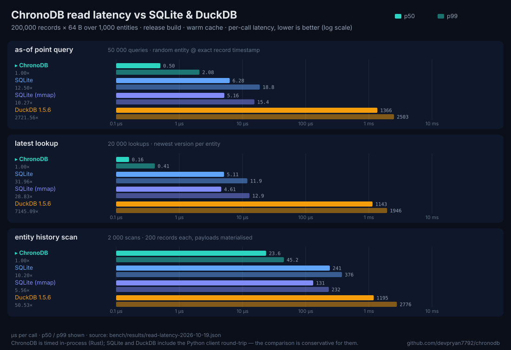
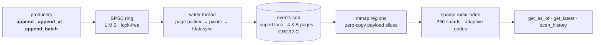

<div align="center">
  
  <br>
  <h3>Append-only versioned records — ask any entity what it looked like at any moment, in half a microsecond.</h3>

  <a href="https://github.com/devpryan7792/chronodb/actions/workflows/ci.yml"></a>
  
  
  
  
  

  <br><br>
</div>

> [!NOTE]
> ChronoDB is a from-scratch storage engine: 4 KiB CRC-verified pages, memory-mapped zero-copy reads, a lock-free SPSC write path and a recovery scanner that never loses an acknowledged write. No WAL to replay, no compaction, no background threads on the read path.

```rust
let engine = Engine::create("events.cdb".as_ref(), EngineOptions::default())?;

engine.append_at(42, 1_700_000_000_000_000_000, b"temperature=21.4")?;
engine.append_at(42, 1_700_000_001_000_000_000, b"temperature=19.8")?;

let past = engine.get_as_of(42, 1_700_000_000_500_000_000)?.unwrap();
assert_eq!(past.payload(), b"temperature=21.4");   // time travel, zero-copy
```

## ✨ Highlights

| | |
|---|---|
| ⏳ **Time travel** | `get_as_of(entity, t)`, `get_latest(entity)`, `scan_history(entity, from, to)` over one append-only file |
| 🪶 **Zero-copy reads** | payloads are borrowed slices of the mapping; page-spanning records are reassembled into `Cow::Owned` |
| 🛡️ **Crash safe** | pages are `fdatasync`ed before their appends are acked; torn tails are cut at open; a `SIGKILL` + bit-flip fuzzer proves no acked write is ever lost |
| 🔒 **Verified data** | CRC32-C over every page and record — SSE 4.2 runtime dispatch with a slicing-by-8 fallback |
| 🧵 **One writer, many readers** | producers share a lock-free SPSC ring, a single writer packs pages, readers never lock the data path |
| 🗑️ **Deletes that travel** | tombstones are versioned records too: `get_as_of` returns `None` after a delete, `get_latest` lets you tell *deleted* from *never seen* |
| 📦 **Tiny surface** | 4 dependencies (`byteorder`, `thiserror`, `parking_lot`, `libc`), MSRV 1.80, no build scripts |
| 🧰 **Batteries included** | `chronodb` benchmark harnesses + `chronoctl` inspect/verify/recover/tail/query |

## 📊 Benchmarks



200 000 records × 64 B over 1 000 entities, release build, warm cache, every query resolved. Full methodology and caveats in [`bench/README.md`](bench/README.md), raw numbers in [`bench/results/`](bench/results):

| workload | ChronoDB | SQLite | SQLite (mmap) | DuckDB |
|---|---|---|---|---|
| as-of point query · p50 / p99 | **0.50 / 2.08 µs** | 6.28 / 18.78 µs | 5.16 / 15.44 µs | 1.37 / 2.50 ms |
| latest lookup · p50 | **0.16 µs** | 5.11 µs | 4.61 µs | 1.14 ms |
| entity scan (200 rec) · p50 | **23.6 µs** | 241 µs | 131 µs | 1.19 ms |
| ingest + index 200k rec | **0.052 s** | 1.22 s | — | 107.9 s |

<details>
<summary>Reproduce it</summary>

```sh
cargo build --release
python3 bench/compare_read.py            # replays the same query sets against SQLite
# optional: DuckDB in an isolated venv
python3 -m venv /tmp/duckvenv && /tmp/duckvenv/bin/pip install duckdb
python3 bench/compare_read.py --duckdb-python /tmp/duckvenv/bin/python
python3 bench/render_charts.py           # regenerate the chart above
```

ChronoDB is timed in-process (Rust); SQLite and DuckDB include the Python client round-trip, which makes the comparison conservative for them. DuckDB's planner serves this workload with a sequential scan (`EXPLAIN ANALYZE`-verified) — it is included for completeness, not as a point-read baseline.
</details>

## 🚀 Quick start

```sh
git clone https://github.com/devpryan7792/chronodb && cd chronodb
cargo run --example time_travel
```

```text
as of +0.5 s -> temperature=21.4 @ 1700000000000000000 ns (lsn 1)
history     -> temperature=21.4 @ 1700000000000000000 ns
history     -> temperature=19.8 @ 1700000001000000000 ns
closed      -> committed lsn 2, durable lsn 2, 2 data pages
reopened    -> temperature=19.8 (as of 1700000001000000000 ns)
```

Appends are acked by policy — `Durability::PerBatch` (default) waits for `fdatasync`, `Durability::OnSync` acks as soon as the page is written. `append` stamps records from the wall clock (clamped monotonic); `append_at` uses an explicit timestamp that must exceed everything committed so far.

## 🧠 How it works



**On-disk format** (little-endian, no compression):

| Structure | Size | Contents |
|---|---|---|
| Superblock | 4096 B | page 0: magic, format version, counters, CRC32-C |
| Page header | 32 B | epoch (= page index), page LSN range, flags, CRC over the page |
| Record header | 44 B | LSN, entity id (`u128`), timestamp (ns), payload length, flags, CRC |
| Payload | ≤ 1 MiB | may span contiguous pages; sealed pages are zero-padded |

<details>
<summary><b>Recovery contract &amp; the two bugs the fuzzer caught</b></summary>

On open, the tail is validated page by page (CRC, page epochs, LSN/timestamp continuity). A torn or corrupt tail is cut back to the first page of the damaged record, the sparse index is rebuilt in one pass, and the writer resumes from the recovered LSN, clock and page cursors. Fuzzed guarantees:

- **Completeness** — every acknowledged write survives a `SIGKILL` mid-append.
- **Soundness** — recovery never invents a record; the recovered set is always a contiguous, byte-exact prefix of what was written.

Adversarial fuzzing (120 randomized tail-damage cases) paid for itself twice:

1. in-flight spanning fragments were being reported as *completed* records;
2. cutting a torn trailing record left a stale page high-water mark, so a resumed writer later failed the strict scan with a "non-zero page after a free page" hole.
</details>

## 🧰 Command line

```text
chronodb bench      [--records N] [--payload B] [--threads T]        # write throughput
chronodb readbench  [--records N] [--entities M] [--queries Q] ...   # read latency + chart data

chronoctl inspect <file>                 # superblock + page/record summary
chronoctl verify  <file> [--repair]      # full CRC walk, optional tail repair
chronoctl recover <file>                 # boot path: what a crash left behind
chronoctl tail    <file> [count]         # last N records
chronoctl query   <file> --id <uuid|hex|dec> [--as-of <rfc3339|unix-ns>]
```

## 🧪 Testing

```sh
cargo test --locked                  # 94 tests, debug
cargo test --locked --release        # same suite, optimised
cargo clippy --all-targets -- -D warnings
cargo fmt --check
```

<details>
<summary>What each suite pins down</summary>

| Suite | Covers |
|---|---|
| `tests/storage_page.rs` | page/record layout, CRC32-C vectors, sealing and span packing |
| `tests/write_path.rs` | ring + writer semantics, both durability policies, batching, concurrency |
| `tests/read_path.rs` | as-of/latest/history resolution, tombstone filtering, mmap growth |
| `tests/recovery.rs` | torn tails, bit flips, partial pages, tombstone and cursor resume |
| `tests/crash_recovery.rs` | `SIGKILL` completeness + the 120-case tail-damage fuzzer |
| `tests/cli_query.rs`, `tests/cli_recover.rs` | `chronoctl` end to end |
</details>

## 🆚 How it compares

|  | ChronoDB | SQLite | DuckDB |
|---|---|---|---|
| as-of point read (p50) | **0.50 µs** | 6.28 µs | 1.37 ms |
| storage model | append-only mmap pages + sparse index | B-tree + WAL | columnar + ART |
| interface | Rust API | SQL | SQL |
| sweet spot | versioned point reads, time-travel queries | general OLTP | analytics / scans |
| best avoided for | joins, ad-hoc SQL, multi-writer workloads | millions of point lookups | latency-sensitive point reads |

## ❓ FAQ

<details>
<summary><b>Is this production ready?</b></summary>

No. v0.1.0 is a complete, tested implementation of the design in [`SPECIFICATION.md`](SPECIFICATION.md), but it is a single-file engine with one writer, a Unix-only I/O layer and no on-disk upgrade path yet. Treat it as a very fast, very honest foundation.
</details>

<details>
<summary><b>Why not just use SQLite?</b></summary>

For general workloads, use SQLite. ChronoDB wins only where the access pattern is *"entity E as of time T"* at scale: it resolves those ~12× faster than SQLite on the same data, returns payloads with zero copies, and needs no query planner, no WAL and no vacuum. In exchange you give up SQL, joins and transactions across entities.
</details>

<details>
<summary><b>How do deletes work?</b></summary>

A delete is just another versioned record with the tombstone flag set. `get_as_of` returns `None` at any time after it, `get_latest` still hands you the tombstone so you can distinguish *deleted* from *never seen*, and `scan_history` shows the full lifecycle — nothing is ever overwritten.
</details>

<details>
<summary><b>What happens on a hard power loss?</b></summary>

Whatever was acknowledged under the configured durability policy is on disk; anything else may be missing or torn. On the next open, the scanner validates page CRCs, epochs and LSN continuity, cuts the file back to the last valid record boundary and resumes. There is no replay step — the repaired file *is* the state.
</details>

<details>
<summary><b>Why CRC32-C instead of xxHash or no checksum at all?</b></summary>

CRC32-C is hardware-accelerated on every x86-64 CPU since ~2010 (`SSE 4.2`), so verification costs a few nanoseconds per record while catching the failure mode that matters in an append-only file: torn or partially-flushed pages. It also lets `chronoctl verify` be a cheap, complete integrity walk.
</details>

## 📁 Project layout

```text
src/
  storage/    on-disk format (page.rs, record.rs), CRC32-C, pwrite layer,
              page packer/writer, recovery + validation scanner
  index/      memory-mapped regions (mmap.rs), sharded adaptive radix index
  engine/     SPSC ring, writer thread, ack slab, read path, Engine facade
  bin/        chronodb (benchmarks) · chronoctl (inspect/repair) CLIs
tests/        layer suites · CLI end-to-end · crash-recovery harness
bench/        SQLite/DuckDB comparison harness, recorded results, chart renderer
assets/       README banner + generated benchmark chart
examples/     time_travel.rs
SPECIFICATION.md   format tables, contracts, roadmap
```

## 🗺️ Roadmap

- [x] Phase 1 — on-disk format, CRC32-C, low-level I/O
- [x] Phase 2 — append-only write path, SPSC ring, LSN counter
- [x] Phase 3 — mmap read path, sparse radix index, as-of queries
- [x] Phase 4 — crash recovery, corruption repair, `chronoctl`
- [x] Phase 5 — power-loss fuzzing, SQLite/DuckDB benchmark suite
- [ ] ARM NEON CRC32-C path (currently software slicing-by-8 on non-x86)
- [ ] Multi-reader concurrency benchmark and cold-cache latency numbers
- [ ] Optional compression codec stage before page seal

## 🤝 Contributing

Issues and PRs are welcome — the fastest way in is a failing test. Before opening a PR, run the four gate commands above; CI runs them on stable and on the MSRV 1.80 toolchain.

## 📜 License

Licensed under either of [Apache-2.0](LICENSE-APACHE) or [MIT](LICENSE-MIT), at your option.
Unless you explicitly state otherwise, any contribution intentionally submitted for inclusion shall be dual-licensed as above, without additional terms.
